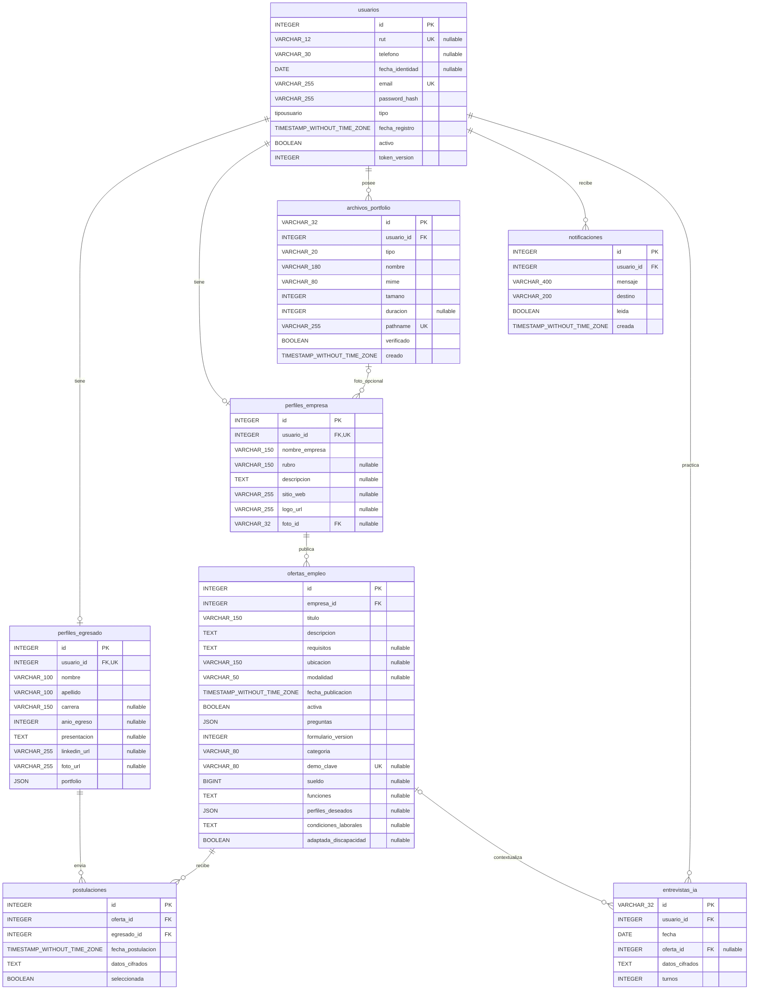

# Diagrama de base de datos de BranchIT

Generado el 19 de octubre de 2026 desde `backend/app/models.py`. Representa las 8 tablas de aplicación y sus 10 claves foráneas, correspondientes al esquema hasta `0008_entrevista_diaria`. No se consultaron registros ni credenciales de Neon. No es una extracción en vivo: refleja los modelos actuales del proyecto.

- `branchit.html`: visor local con zoom.
- `branchit.png`: imagen para presentaciones.
- `branchit.svg`: imagen vectorial ampliable sin pérdida de calidad.
- `branchit.mmd`: fuente editable en Mermaid.
- `branchit.sql`: DDL PostgreSQL de referencia, NO ejecutar sobre una base existente.
- `branchit.schema.json`: inventario de columnas y claves.

Se excluyen `alembic_version` y los esquemas de respaldo. Las flechas del dibujo van desde la tabla que contiene la FK hacia la tabla referenciada.

Los perfiles de egresado y empresa se vinculan mediante `usuario_id` único. El tipo de cuenta y la aplicación determinan qué perfil corresponde a cada usuario. La FK de foto de empresa es opcional; la propiedad del archivo se valida en la API. Borrar una oferta deja nula su referencia en entrevistas IA (`ON DELETE SET NULL`).

Las experiencias laborales, habilidades, proyectos, certificaciones y enlace al título están dentro del JSON `perfiles_egresado.portfolio`, por lo que no aparecen como tablas independientes. Los binarios de fotos, videos y documentos se almacenan en Vercel Blob; `archivos_portfolio` conserva sus metadatos. Las respuestas y antecedentes de la postulación se guardan en `postulaciones.datos_cifrados`, y la conversación de entrevista en `entrevistas_ia.datos_cifrados`.

## Fuente editable

